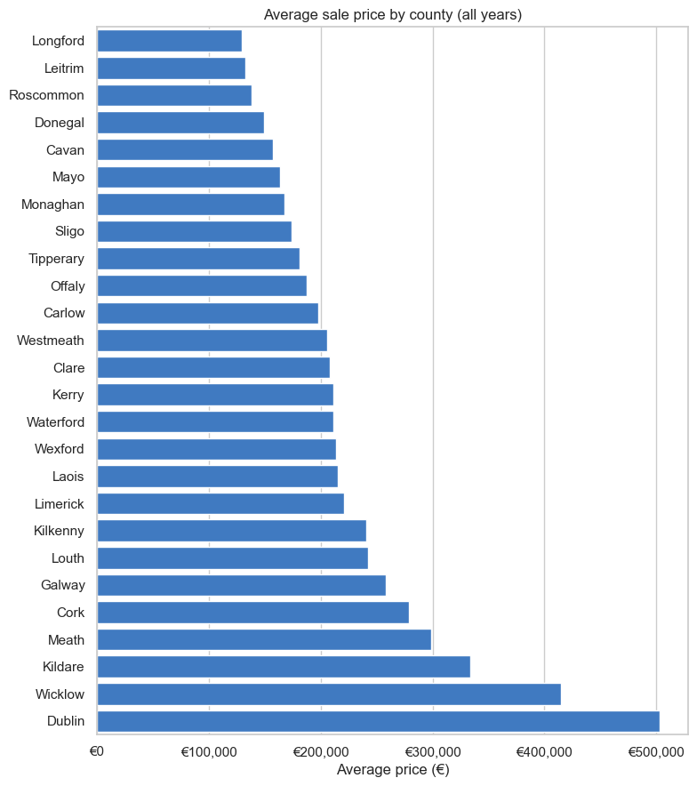

# Irish Housing ML — Property Price Register Analysis

An end-to-end data science project on real Irish residential property
sales: download the official Property Price Register, load it into
SQLite, explore it with SQL, and train two scikit-learn regression models
to predict sale price from county, year, and property type — with an
honest look at how well that actually works, and why.


*Average residential sale price by county across all 797,774 sales in the register, from 2010 to mid-2026, queried from SQLite.*

```
scripts/download_data.py  -->  data/raw/PPR-ALL.csv        (raw register, ~800k sales)
scripts/load_to_sqlite.py -->  data/processed/housing.db   (cleaned, typed, indexed)
sql/queries.sql            +   notebooks/01_sql_exploration.ipynb  (SQL-first EDA)
                                notebooks/02_modeling.ipynb          (feature engineering, 2 models, evaluation)
```

## The data source

The **Property Price Register (PPR)**, published by the Property Services
Regulatory Authority (PSRA) at
[propertypriceregister.ie](https://propertypriceregister.ie), is Ireland's
official record of residential property sale prices — every sale in the
country since 1 January 2010, self-reported by the buyer's solicitor. It's
public, free, and needs no API key or signup: the site publishes one bulk
"download all" ZIP (`scripts/download_data.py` fetches it directly).

At the time of writing, that file contains **797,774 sale records**
spanning 2010 to mid-2026.

**What's in it:** date of sale, address, county, price, whether the sale
was at full open-market price, whether VAT-exclusive, and whether the
property was new or second-hand.

**What's *not* in it**, which matters a lot for the modelling section
below: floor area and bedroom count (only sparsely present), exact
geographic location beyond county (Eircode is filled in for very few
rows), and property condition.

## Setup

```bash
python -m venv .venv
source .venv/bin/activate        # on Windows: .venv\Scripts\activate
pip install -r requirements.txt
```

## Usage

```bash
# 1. Download the current register (~19MB zipped, ~104MB unzipped)
python scripts/download_data.py

# 2. Clean it and load it into SQLite
python scripts/load_to_sqlite.py

# 3. Explore it with SQL
sqlite3 data/processed/housing.db < sql/queries.sql   # or open the queries in any SQLite client
jupyter notebook notebooks/01_sql_exploration.ipynb   # same queries, executed, with charts

# 4. Train and evaluate the models
jupyter notebook notebooks/02_modeling.ipynb
```

`data/raw/` and `data/processed/` are gitignored — the raw CSV and the
SQLite database are both 100MB+ (over GitHub's per-file limit anyway), and
both are fully regenerated by the two scripts above, so there's nothing
gained by trying to commit them.

## What the SQL exploration found

(Full detail, with charts, in `notebooks/01_sql_exploration.ipynb`; the
raw queries are in `sql/queries.sql`.)

- **County matters enormously.** Average price ranges from Dublin's
  ~€497,000 down to well under half that in several rural counties.
- **Growth hasn't been uniform.** Comparing 2011 to 2025 (the latest full
  year), Westmeath's average price grew ~162% while Sligo's grew ~58%.
  Dublin, already the most expensive county, still grew ~116% over the
  same period. This unevenness is exactly why a single national trend
  line undersells some counties and oversells others — see the modelling
  section below.
- **New builds sell for more on average than second-hand** (roughly
  €418,000 vs. €298,000) — expected, since new builds tend to be larger
  and in newer developments, but a real, consistent gap in the data.
- **About 5% of all sales are flagged "not full market price"** (e.g.
  family transfers) and are excluded before any modelling, since they
  don't reflect what a buyer actually pays.
- **Floor area is missing for the large majority of sales** — it's only
  required to be declared for some new-build transactions — which is the
  main reason the model below can't use it.

## The model

**Question:** given only a sale's county, year, and property type
(new/second-hand), how well can we predict its price?

That's a deliberately narrow question — those are the only features the
register reliably provides for (almost) every sale. Framing it this way
up front matters more than it might seem: it sets a realistic ceiling on
"how good can this possibly get" before looking at a single metric.

**Filtering before modelling** (in addition to excluding non-market-price
sales): prices below €10,000 or above €2,000,000 are dropped. The high
end includes bulk sales of entire apartment blocks to investment funds,
recorded as a single "sale" — these would badly distort a model meant to
predict the price of one home. This drops about 0.6% of sales; it's a
blunt filter and it also excludes some genuinely expensive individual
homes, which is a real trade-off, not a free one.

**Target:** `log(price)`, not raw price — prices are right-skewed, and a
€20k error means something different on an €80k home than an €800k one.
Predictions are converted back to euro (via `exp()`) before computing the
metrics below, so they're directly readable as money.

**Models compared** (train/test split: 80/20, random, `random_state=42`):

| Model | Test R² (log scale) | Test MAE | Test RMSE | Test R² (€ scale) |
|---|---|---|---|---|
| Linear Regression | 0.399 | €113,206 | €187,946 | 0.266 |
| Random Forest | 0.426 | €110,227 | €186,104 | 0.281 |

(These are real numbers from the last run of `notebooks/02_modeling.ipynb`
against the full ~752k-row filtered dataset — not illustrative
placeholders.)

**Random Forest wins on every metric**, though not by a huge margin. The
likely reason: county-level price growth wasn't uniform over time (see
the SQL findings above), which is a county × year *interaction*. Linear
Regression, as built here, can only apply one single national "price per
year" slope; Random Forest can effectively learn a different trend per
county without anyone hand-engineering that interaction.

## Being honest about what this model does and doesn't show

This is the part that matters most, and it's worth stating plainly rather
than burying it:

- **R² around 0.4 (log scale) means county + year + property type explain
  well under half the variation in price.** The rest — floor area,
  bedrooms, exact location, condition, garden, whether it's on a busy
  road — isn't in this dataset, and no amount of modelling can recover
  information that was never collected.
- **A typical prediction is off by roughly €110,000-113,000 (test MAE).**
  That's informative at the level of "this county/year/type combination
  tends to sell in roughly this range," and not remotely precise enough
  to price an individual home.
- **County is a coarse feature**, especially for Dublin, which spans some
  of the country's cheapest and most expensive areas under one label. This
  is very likely the single biggest ceiling on model quality here, and
  postcode- or small-area-level location would probably be the single
  biggest improvement.
- **Interest rates aren't in the model at all.** Irish mortgage rates
  moved substantially across 2010-2026; some of what the model attributes
  to "county" and "year" trends is plausibly actually a borrowing-cost
  effect that a flat `year` coefficient can't separate out.
- **The €10k-€2M filter means the model has never seen, and will not
  sensibly predict, prices outside that band.**

**In short: this model is a reasonable demonstration of the workflow
(clean data → SQL exploration → feature engineering → train/test →
compare models → evaluate honestly), and a genuine, if rough, illustration
of *why* Dublin and *why* recent years cost more — but it is not, and
shouldn't be mistaken for, a property valuation tool.**

### If someone wanted to take this further

- Bring in CSO's Residential Property Price Index or a mortgage interest
  rate series as an explicit national/regional trend feature, instead of
  asking a flat `year` coefficient to carry that whole story.
- Geocode addresses to get sub-county location (Eircode is present for
  very few rows, unfortunately, so this means real address-parsing work).
- Fit a separate model just for the subset of new-build sales that do
  report floor area (`size_description`) — likely a meaningfully stronger
  model, just for a smaller slice of the market.
- Try gradient boosting (e.g. `HistGradientBoostingRegressor`) as a third
  comparison point.

## Notes on design choices

- **SQLite, not just pandas-on-CSV.** At ~800k rows, "average price per
  county per year" is meaningfully faster as a GROUP BY over an indexed
  table than a full CSV re-scan, and writing the cleaning logic once at
  load time means every notebook sees identically-typed dates and prices.
- **cp1252 encoding.** The source CSV isn't UTF-8 — it's Windows-1252
  (visible from the "Price (€)" column header, which only decodes
  correctly as cp1252). `load_to_sqlite.py` handles this explicitly.
- **Charts use one blue hue for magnitude** (prices, counts) and a second
  accent color only where genuinely comparing two named things (e.g. the
  two models), consistent with treating color as "how much" vs. "which
  one," not decoration.
